# ENSEA_2526_ESE_AAA_CHEIKH-SIDIYA_TSAMO_Florette — Commande MCC via hacheur (Nucleo-STM32G474RE)

## Équipe

- Florette Miroslava TSAMO
- Abdellahi CHEIKH-SIDIYA

Encadrants : Alexis MARTIN, Nicolas PAPAZOGLOU

## Sommaire

1. [Objectif du projet](#objectif-du-projet)
2. [Architecture matérielle](#architecture-matérielle)
3. [Organisation du code](#organisation-du-code)
4. [Section 6 — Commande MCC basique](#section-6--commande-mcc-basique)
5. [Section 7 — Commande en boucle ouverte et mesures](#section-7--commande-en-boucle-ouverte-et-mesures)
6. [Problèmes rencontrés](#problèmes-rencontrés)
7. [Bilan et travail restant](#bilan-et-travail-restant)

## Objectif du projet

Dans ce TP, nous disposions d'un hacheur complet et d'une carte Nucleo-STM32G474RE. L'objectif était de :

1. commander les 4 transistors du hacheur en commande complémentaire décalée ;
2. faire l'acquisition des différents capteurs (courant, vitesse) ;
3. réaliser l'asservissement en temps réel de la vitesse du moteur.

## Architecture matérielle

Nous avons commencé par étudier le schéma KiCad de la carte de puissance pour identifier les composants et les broches utiles :

- **Carte de puissance** : hacheur 3 bras (U, V, W) à base de MOSFET IRF540N, pilotés par des drivers isolés HCPL-315J. Nous n'utilisons que les bras **U** et **V**, qui forment un pont en H aux bornes de la MCC.
- **Carte de commande** : Nucleo-STM32G474RE, horloge système à 170 MHz.
- **Capteurs de courant** : LEM GO 10-SME/SP3 (effet Hall, alimentation 3,3 V), l'un sur la phase U, l'autre sur le bus continu.
- **Codeur incrémental** du moteur (voies A, B, Z), relié à TIM3.

| Fonction | Broche STM32 | Périphérique |
|---|---|---|
| Bras U, transistor haut | PA8 | TIM1_CH1 |
| Bras U, transistor bas | PB13 | TIM1_CH1N |
| Bras V, transistor haut | PA9 | TIM1_CH2 |
| Bras V, transistor bas | PB14 | TIM1_CH2N |
| Bras W (non utilisé) | PA10 / PB15 | TIM1_CH3 / CH3N |
| Courant phase U (`U_Imes`) | PA1 | ADC1_IN2 |
| Courant de bus (`Bus_Imes`) | PC2 | ADC1_IN8 |
| Signal de synchronisation ADC (`ADC_SYNC`) | PC7 | GPIO |
| Shell (terminal série) | PA2 / PA3 | USART2, 115200 bauds |

## Organisation du code

Nous avons conservé l'arborescence du projet fourni et réparti le code par fonction :

```
TP/software/Base/Core/Src/
├── app.c                        initialisation (init_device), commandes du shell, boucle principale
├── acquisition/
│   ├── input_analog.c           mesure des courants : TIM1 -> ADC1 -> DMA, commande CURRENT
│   └── input_encoder.c          mesure de vitesse (codeur)
├── motor_control/
│   ├── motor.c                  commandes start, stop, SET_CCR, speed
│   └── asserv.c                 asservissement (non réalisé)
└── user_interface/
    ├── shell.c                  terminal de commande via UART2
    ├── led.c                    LED utilisateur
    └── button.c                 bouton utilisateur
```

---

## Section 6 — Commande MCC basique

### 6.1 — Génération des 4 PWM

Pour générer les 4 signaux de commande, nous utilisons TIM1, le timer avancé du STM32 : c'est le seul qui dispose de sorties complémentaires (CHx / CHxN) avec insertion matérielle d'un temps mort. Nous l'avons configuré ainsi :

| Paramètre | Valeur | Justification |
|---|---|---|
| Fréquence PWM | 20 kHz | cahier des charges |
| Mode de comptage | Center Aligned Mode 1 | le compteur monte puis descend : les impulsions des deux bras sont centrées sur le même instant |
| Prescaler | 0 | pas de division |
| Period (ARR) | 4249 | en mode centré : f = 170 MHz / (2 × (ARR + 1)), donc ARR = 170 MHz / (2 × 20 kHz) − 1 = 4249 |
| Résolution | 4250 pas (environ 12 bits) | supérieure aux 10 bits demandés |
| Mode des canaux | PWM mode 1 sur CH1 et CH2 | voir la commande décalée ci-dessous |
| Temps mort | DTG = 17, soit 100 ns | DTG = 100 ns × 170 MHz = 17. Le temps mort doit dépasser le temps de blocage d'un MOSFET, soit td(off) + tf ≈ 39 + 35 = 74 ns d'après la datasheet de l'IRF540N (RG = 5,1 Ω). 100 ns laisse une marge d'environ 25 ns tout en limitant la distorsion de tension due au temps mort |

**Commande complémentaire décalée.** Nous envoyons la consigne au bras U et son complément au bras V :

```
CCR1 = CCR            (bras U, rapport cyclique α = CCR / ARR)
CCR2 = ARR − CCR      (bras V, rapport cyclique 1 − α)
```

Comme le compteur est en mode centré, les impulsions des deux bras restent centrées sur le même instant. La tension aux bornes du moteur présente alors deux impulsions par période PWM : sa fréquence apparente est de 40 kHz, ce qui réduit l'ondulation du courant. Sa valeur moyenne vaut :

```
<U_moteur> = (2α − 1) × Vbus
```

Elle est nulle à 50 %, positive au-dessus (marche avant) et négative en dessous (marche arrière).

**Vérification à l'oscilloscope.** Nous avons relevé les 4 signaux sur les voies numériques de l'oscilloscope (CH1 = PA8, CH1N = PB13, CH2 = PA9, CH2N = PB14, 40 µs/div) pour plusieurs rapports cycliques :

<table>
<tr>
<td align="center">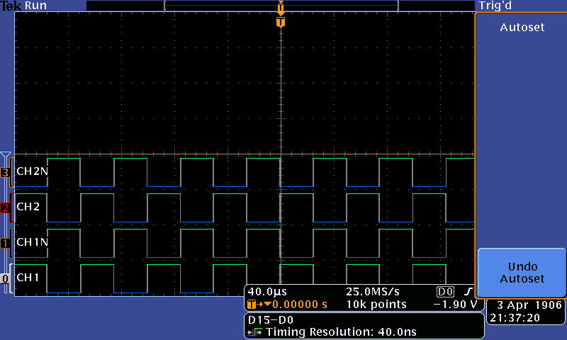<br><b>50 %</b> (CCR = 2125)</td>
<td align="center">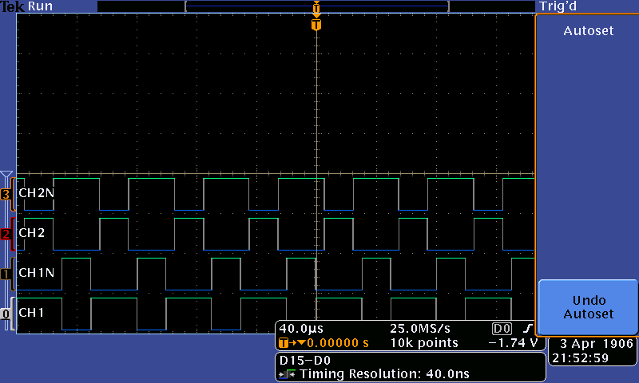<br><b>60 %</b> (CCR = 2549)</td>
</tr>
<tr>
<td align="center">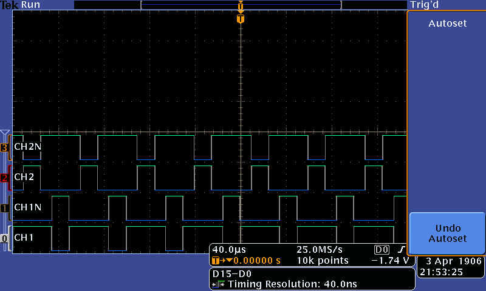<br><b>70 %</b> (CCR = 2974)</td>
<td align="center">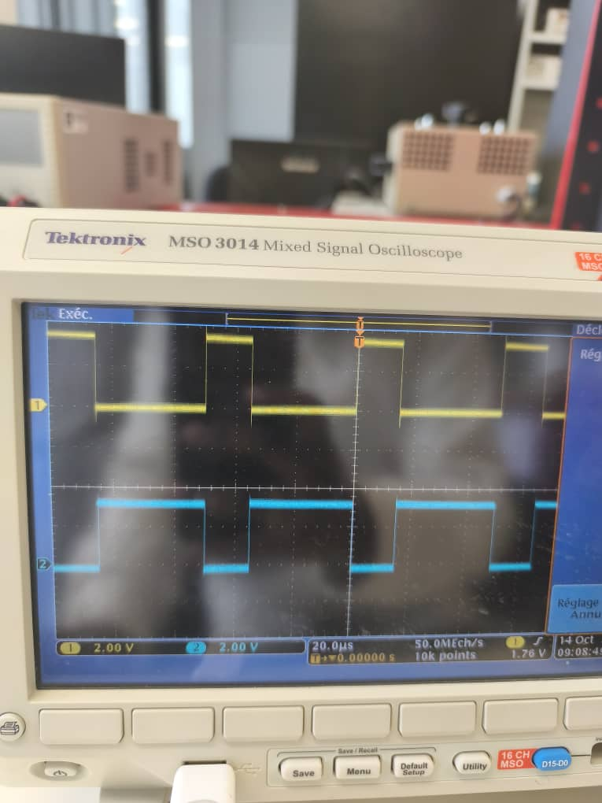<br>Premiers signaux PWM observés (14 octobre)</td>
</tr>
</table>

Ces mesures nous ont montré que :

- la période est de 50 µs, soit bien **20 kHz** ;
- sur chaque bras, les deux sorties sont complémentaires (CH1 / CH1N, CH2 / CH2N) ;
- à **50 %**, CH1 et CH2 sont identiques : les deux bras ont le même rapport cyclique, la tension moyenne aux bornes du moteur est nulle ;
- à **60 %** et **70 %**, CH1 est à l'état haut 60 % (respectivement 70 %) du temps, et CH2 seulement 40 % (respectivement 30 %). Les deux impulsions restent centrées sur le même instant, et CH2N correspond à CH1 décalé d'une demi-période (25 µs) : c'est bien la commande décalée attendue ;
- le temps mort de 100 ns n'est pas visible à 40 µs/div ; il s'observe en zoomant sur un front, à environ 100 ns/div.

### 6.2 — Commande du rapport cyclique via UART

Pour piloter le moteur depuis le PC, nous utilisons le shell fourni (`shell.c`), qui communique par l'USART2 de la Nucleo. Nous y avons ajouté la commande :

```
SET_CCR XXXX
```

Elle est traitée par `motor_set_ccr()` (`motor.c`) :

1. le shell détecte la commande `SET_CCR` ;
2. nous vérifions que l'argument est présent et commence par un chiffre ; sinon le message `Usage : SET_CCR XXXX` s'affiche ;
3. nous convertissons l'argument en entier et vérifions qu'il ne dépasse pas ARR. Une valeur trop grande n'est **pas** tronquée : le message `ERREUR : CCR doit etre entre 0 et 4249` s'affiche et la consigne n'est pas modifiée ;
4. sinon, nous appliquons `CCR1 = CCR` sur le bras U et `CCR2 = ARR − CCR` sur le bras V.

La valeur à envoyer s'obtient par `CCR = α × 4249` :

| Rapport cyclique | Commande |
|---|---|
| 50 % (arrêt) | `SET_CCR 2125` |
| 60 % | `SET_CCR 2549` |
| 70 % | `SET_CCR 2974` |
| 100 % | `SET_CCR 4249` |

Lors des premiers essais, nous ne parvenions pas à saisir la commande : le shell rejetait le caractère `_`. Nous l'avons ajouté à la liste des caractères acceptés (`is_character_valid()`).

<table>
<tr>
<td align="center">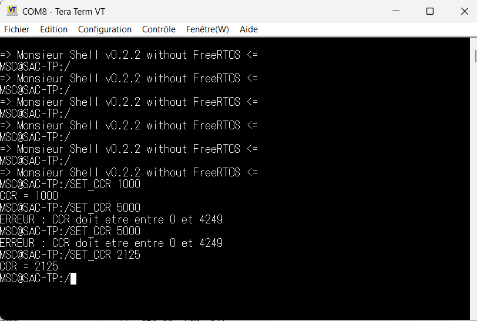<br>Valeur hors limites refusée avec un message d'erreur</td>
<td align="center">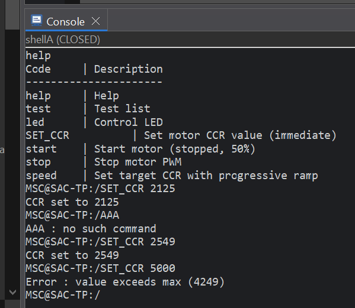<br>Liste des commandes (<code>help</code>)</td>
</tr>
<tr>
<td align="center" colspan="2">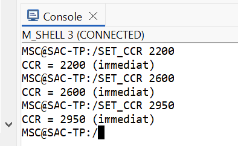<br>Consignes utilisées pendant les mesures de courant (7.2)</td>
</tr>
</table>

### 6.3 — Premiers tests moteur

Nous avons ensuite branché le moteur et observé la tension à ses bornes (voie 2, en cyan) :

<table>
<tr>
<td align="center"><br><b>50 %</b> : CH1 et CH2 identiques</td>
<td align="center">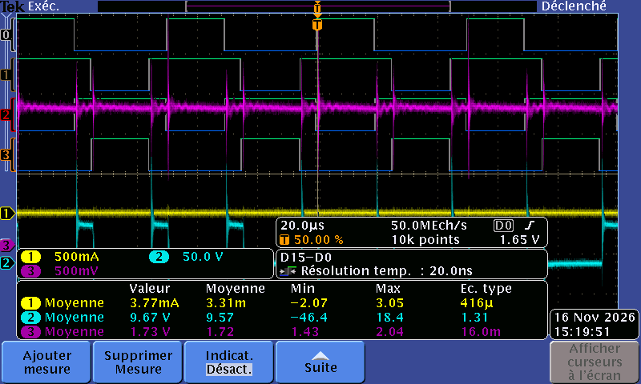<br><b>Plus de 65 % environ</b> : tension moyenne de 9,6 V aux bornes du moteur</td>
</tr>
</table>

- **À 50 %**, les deux bras ont le même rapport cyclique : la tension moyenne aux bornes du moteur est nulle et le moteur reste à l'arrêt.
- **Au-delà de 65 % environ**, la tension aux bornes du moteur présente deux impulsions par période PWM et sa valeur moyenne atteint 9,6 V : le moteur tourne.
- **Passage brutal de 50 % à plus de 65 %.** À l'arrêt, le moteur ne présente que la résistance de son induit, sans force contre-électromotrice. Appliquer d'un coup une tension moyenne de près de 10 V provoque donc un fort appel de courant et un à-coup mécanique. Pour l'éviter, nous avons ajouté une commande qui fait varier le rapport cyclique progressivement (`speed`, voir 7.1).

---

## Section 7 — Commande en boucle ouverte et mesures

### 7.1 — Commande de vitesse

Nous avons regroupé toutes les commandes du shell dans `app_shell_commands_init()` (`app.c`) :

| Commande | Effet |
|---|---|
| `start` | met CCR à 50 % (vitesse nulle) puis démarre les 4 sorties PWM |
| `stop` | arrête les 4 sorties PWM |
| `SET_CCR XXXX` | applique immédiatement CCR = XXXX |
| `speed XXXX` | atteint CCR = XXXX par une rampe de 10 pas toutes les 10 ms, soit environ 0,85 s pour passer de 50 % à 70 % |
| `CURRENT` | affiche les courants mesurés (voir 7.2) |

### 7.2 — Mesure du courant

#### Capteur et fonction de transfert

Dans le schéma KiCad, nous avons d'abord pensé que le courant était mesuré par le HCPL-7800. En suivant les signaux `Imes`, nous avons constaté que le HCPL-7800 sert en réalité à mesurer la tension de phase, et que le courant est mesuré par un capteur à effet Hall **LEM GO 10-SME/SP3**. C'est donc sa fiche technique que nous avons utilisée :

| Caractéristique | Valeur |
|---|---|
| Alimentation | 3,3 V (capteur ratiométrique) |
| Tension de sortie à courant nul (Vref) | 1,65 V |
| Sensibilité (S) | 50 mV/A |
| Courant nominal | 10 A |
| Plage de mesure | ± 25 A, soit une sortie de 0,40 V à 2,90 V |

La sortie du capteur est lue par l'ADC1 sur 12 bits, avec une référence de 3,3 V :

```
Tension lue par l'ADC   :  V = 3,3 × N / 4095                 (N : valeur brute, 0 à 4095)
Fonction du capteur     :  V = Vref + S × I
Courant                 :  I = (V − 1,65) / 0,050             (en A)
En une formule          :  I ≈ (N − 2048) × 16,1 mA
```

Un pas de l'ADC (0,81 mV) correspond donc à environ **16 mA**. Avant les essais, nous avons calculé les valeurs attendues :

| Courant | Tension capteur | Valeur ADC attendue |
|---|---|---|
| −10 A | 1,15 V | ≈ 1427 |
| −1 A | 1,60 V | ≈ 1986 |
| 0 A | 1,65 V | ≈ 2048 |
| +1 A | 1,70 V | ≈ 2110 |
| +10 A | 2,15 V | ≈ 2668 |

#### Étape 1 : mesure en polling

Dans une première version, la commande du shell lançait une conversion (`HAL_ADC_Start`), attendait sa fin (`HAL_ADC_PollForConversion`) puis lisait le résultat (`HAL_ADC_GetValue`).

Cette méthode nous a montré ses limites : la conversion a lieu à un instant quelconque de la période PWM. Or le courant moteur ondule à 40 kHz autour de sa valeur moyenne, et le courant de bus est découpé (il ne circule que lorsque le pont alimente le moteur). Les valeurs lues variaient donc fortement d'une mesure à l'autre.

#### Étape 2 : chaîne TIM1 → ADC1 → DMA synchronisée sur la PWM

Pour obtenir une mesure stable, nous déclenchons l'ADC directement par TIM1, au même instant de chaque période PWM, et laissons le DMA ranger les résultats en mémoire :

| Périphérique | Réglage |
|---|---|
| TIM1 | Trigger Event Selection TRGO = Update Event, Repetition Counter = 1 : un déclenchement par période PWM (20 kHz) |
| ADC1 | déclenchement externe sur TIM1 TRGO (front montant), 2 conversions : rang 1 `U_Imes` (IN2), rang 2 `Bus_Imes` (IN8), temps d'échantillonnage 47,5 cycles |
| ADC1 | DMA Continuous Requests activé, Overrun data overwritten |
| DMA1 Channel 1 | mode circulaire, demi-mot (16 bits) |

Le fonctionnement, dans `input_analog.c`, est le suivant :

1. `input_analog_init()` calibre l'ADC (`HAL_ADCEx_Calibration_Start`) puis lance la chaîne avec `HAL_ADC_Start_DMA`.
2. À chaque période PWM, TIM1 déclenche la conversion des deux voies, et le DMA range les deux résultats dans `adc_dma_buffer` sans intervention du processeur.
3. `HAL_ADC_ConvCpltCallback()`, appelée à 20 kHz, recopie les valeurs brutes et génère une impulsion sur `ADC_SYNC` (PC7). Nous utilisons cette impulsion pour vérifier à l'oscilloscope que les mesures sont synchrones de la PWM.
4. `HAL_ADC_ErrorCallback()` relance la chaîne ADC + DMA en cas d'overrun.
5. La commande `CURRENT` convertit les valeurs en mA et affiche `Iu`, `Ibus`, les valeurs brutes, le nombre de mesures et le nombre d'erreurs.

**Pourquoi cet instant de mesure.** L'Update Event de TIM1 a lieu quand le compteur atteint 0 ou ARR. En commande décalée, ces instants tombent au milieu des phases de roue libre, là où le courant, qui ondule en triangle, passe par sa valeur moyenne. La mesure donne ainsi directement le courant moyen, sans filtrage. En revanche, à cet instant le pont n'appelle pas de courant au bus : `Ibus` mesuré de façon synchrone est proche de 0, et c'est `Iu` qui donne le courant du moteur.

#### Validation à l'oscilloscope

Pour valider la mesure, nous avons comparé, pour plusieurs consignes, le courant donné par une sonde de courant et la sortie du capteur. Voies analogiques : voie 1 (jaune) sonde de courant, 500 mA/div ; voie 2 (cyan) tension aux bornes du moteur, 50 V/div ; voie 3 (violet) sortie du capteur `U_Imes`, 500 mV/div. Voies numériques : signaux PWM. Base de temps : 20 µs/div.

| Capture | Courant moyen (sonde) | Tension moyenne moteur | Sortie capteur | Courant déduit du capteur, (V − 1,65) / 0,05 |
|---|---|---|---|---|
| 15h25m21 | 1,36 A | 9,85 V | 1,70 V | 1,0 A |
| 15h25m31 | 1,70 A | 9,79 V | 1,72 V | 1,4 A |
| 15h27m47 | sonde saturée, < −1,96 A | −13,4 V | 1,56 V | −1,8 A |
| 15h28m14 | −0,08 A | 0,82 V | 1,66 V | 0,2 A |

Ces mesures nous ont montré que :

- la sortie du capteur suit bien le courant : environ 1,56 V en marche arrière, 1,66 V près de l'arrêt, 1,70 à 1,72 V en marche avant, autour de 1,65 V à courant nul ;
- l'écart entre la sonde et la valeur déduite du capteur reste de quelques centaines de mA. Il s'explique par l'offset réel du capteur et par la résolution de la voie 3 (moyenne affichée à 10 mV près, soit 0,2 A) ;
- **la valeur affichée par la commande `CURRENT` correspond à celle mesurée par la sonde de courant de l'oscilloscope** : la chaîne de mesure est validée ;
- le signe de la tension moyenne aux bornes du moteur suit le rapport cyclique : positive au-dessus de 50 %, négative en dessous, proche de 0 autour de 50 %.

<table>
<tr>
<td align="center">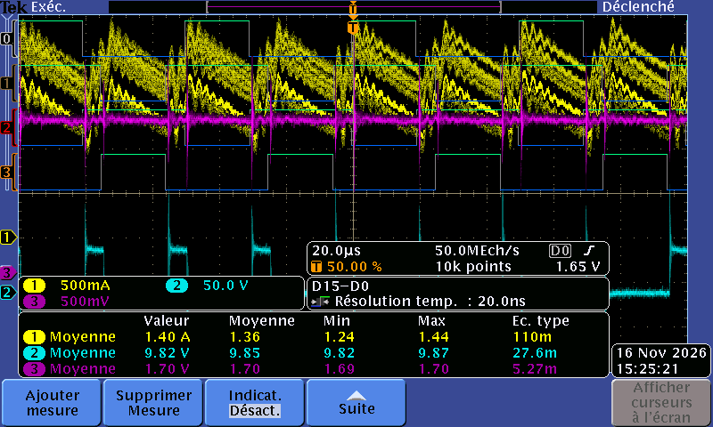<br>15h25m21 : marche avant, 1,36 A</td>
<td align="center">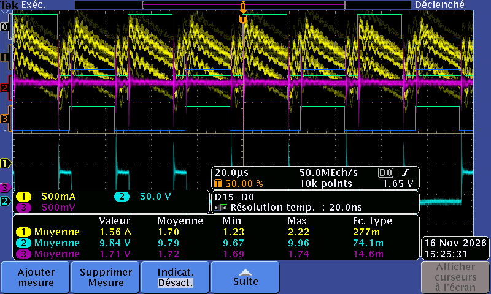<br>15h25m31 : marche avant, 1,70 A</td>
</tr>
<tr>
<td align="center">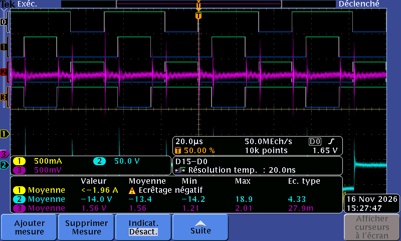<br>15h27m47 : marche arrière (sonde saturée)</td>
<td align="center">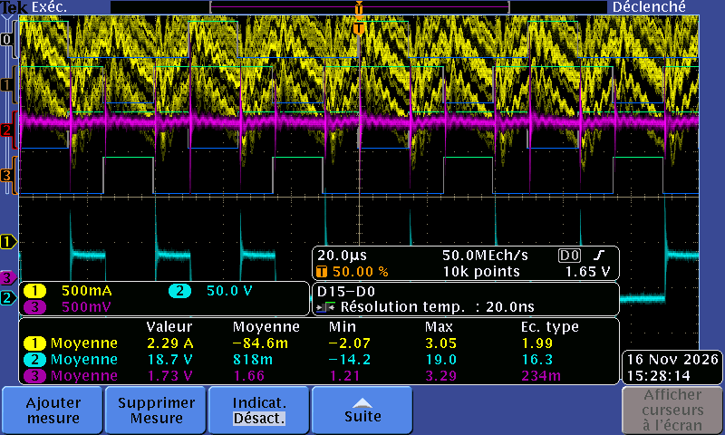<br>15h28m14 : près de 50 %, courant quasi nul</td>
</tr>
<tr>
<td align="center">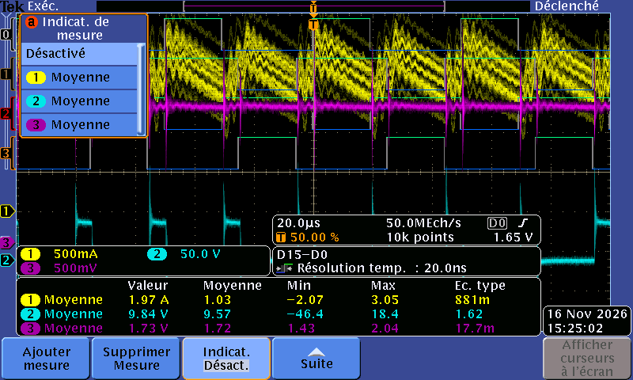<br>15h25m02 : établissement du courant</td>
<td align="center">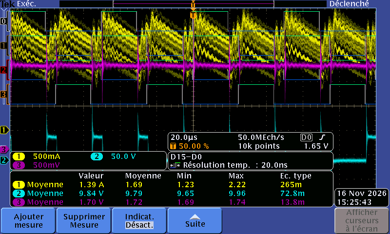<br>15h25m43 : marche avant, 1,69 A</td>
</tr>
<tr>
<td align="center"><br>15h27m19 : marche arrière</td>
<td align="center">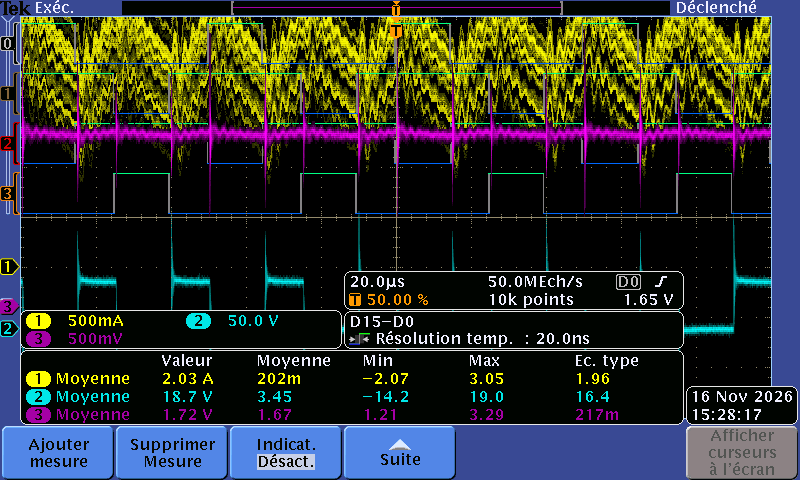<br>15h28m17 : faible rapport cyclique, 0,20 A</td>
</tr>
</table>

### 7.3 — Mesure de la vitesse

Nous avons écrit le code de la mesure de vitesse, mais **nous n'avons pas eu le temps de le tester sur le banc**.

Le principe retenu : les voies A et B du codeur incrémental sont lues par TIM3 en mode codeur. Le compteur s'incrémente ou se décrémente à chaque front selon le sens de rotation, et nous obtenons la vitesse en relevant la variation du compteur sur une durée fixe :

```
Ω [tr/s] = Δcompteur / (4 × N_impulsions_par_tour × Δt)
```

Le facteur 4 vient du comptage des fronts montants et descendants des deux voies.

---

## Problèmes rencontrés

- **Fréquence PWM de 40 kHz au lieu de 20 kHz.** Lors de la première mesure, nous avons relevé une période de 25 µs au lieu de 50 µs. TIM1 était resté en comptage croissant (edge-aligned) : avec ARR = 4249, la période valait (ARR + 1) / 170 MHz = 25 µs, soit 40 kHz, et les impulsions des deux bras commençaient en même temps, sans décalage. Nous avons corrigé en passant TIM1 en Center Aligned Mode 1.

  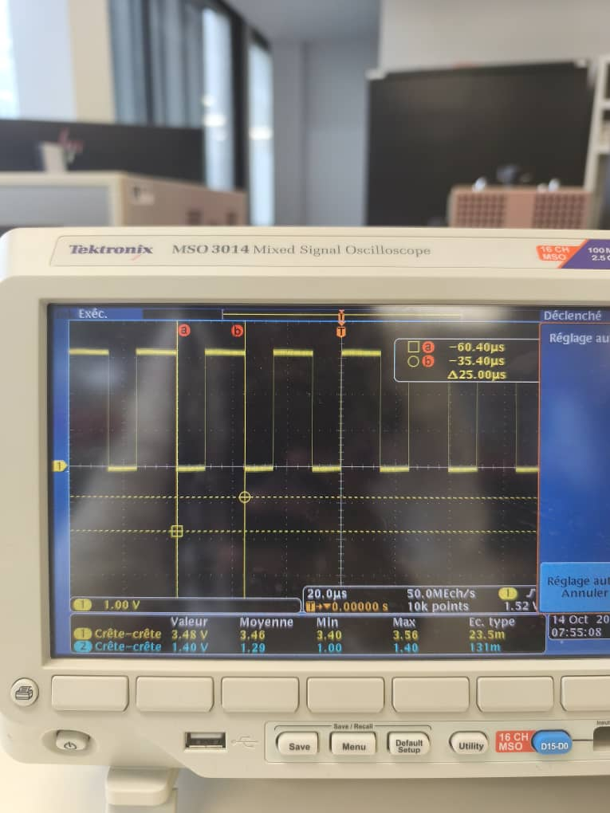<br>
  *Mesure aux curseurs : 25 µs entre deux fronts montants, soit 40 kHz.*

- **Les deux bras avaient le même rapport cyclique.** Sur cette capture, CH1 et CH2 ont la même largeur d'impulsion, simplement décalées d'une demi-période. Le canal 2 était en PWM mode 2 alors que le code lui envoyait déjà `ARR − CCR` : les deux inversions s'annulaient, et la tension moyenne aux bornes du moteur restait nulle quelle que soit la consigne. Nous avons corrigé en passant CH2 en PWM mode 1. Après cette correction, les signaux étaient conformes à la commande décalée, comme le montrent les captures à 50 %, 60 % et 70 % du paragraphe 6.1.

  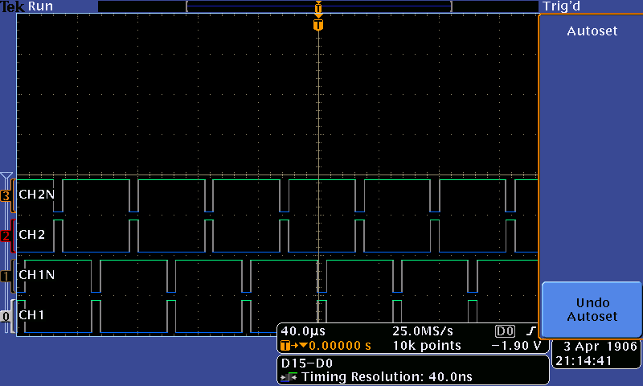<br>
  *Avant correction : CH1 et CH2 ont la même largeur d'impulsion.*

- **Mesure DMA qui ne démarrait pas.** La requête DMA était bien configurée, mais l'ADC restait en démarrage logiciel (`ADC_SOFTWARE_START`) et TIM1 n'envoyait pas de TRGO (`TIM_TRGO_RESET`). L'ADC ne faisait donc qu'une seule séquence. Nous avons corrigé en déclenchant l'ADC sur TIM1 TRGO, en réglant le TRGO sur Update Event et en activant DMA Continuous Requests.

- **Mesure en polling bloquante.** Avec `HAL_MAX_DELAY`, une conversion qui ne se terminait pas bloquait tout le microcontrôleur, y compris le shell. Nous avons remplacé cette attente infinie par un timeout fini, suivi d'un message d'erreur.

- **`printf` des flottants.** La bibliothèque newlib-nano ne gère pas `%f` par défaut. Nous affichons donc les courants en mA (entiers), ce qui évite l'option de link `-u _printf_float`.

- **Fichiers ajoutés absents du build.** Dans la première version du projet (CMake), `app.c`, `shell.c`, `led.c` et `motor.c` n'étaient pas listés dans `target_sources`, d'où l'erreur `undefined reference to init_device`. Nous les avons ajoutés à la main : CubeMX ne gère que ses propres fichiers générés.

## Bilan et travail restant

Au terme des séances de TP, nous avons réalisé et validé :

- la commande complémentaire décalée des 4 transistors à 20 kHz, avec temps mort, vérifiée à l'oscilloscope à 50 %, 60 % et 70 % ;
- le pilotage du moteur depuis le shell (`start`, `stop`, `SET_CCR`, `speed`), avec rejet des valeurs hors limites ;
- la mesure du courant moteur par la chaîne TIM1 → ADC1 → DMA synchronisée sur la PWM, dont les valeurs concordent avec la sonde de courant de l'oscilloscope.

Il restait à faire :

- tester la mesure de vitesse, dont le code est écrit, puis relever la constante de temps mécanique du moteur ;
- exploiter les mesures de tension (tensions de phase et tension de bus, reliées à l'ADC2) ;
- mettre en place l'asservissement en temps réel : d'abord la boucle de courant, à partir de `Iu` mesuré par DMA, puis la boucle de vitesse.
